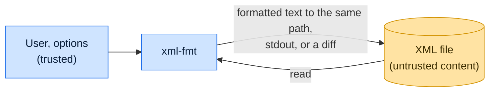

# Threat model

This model says what xml-fmt trusts, where untrusted input enters, and which guarantees hold at each boundary, so a
report can be classified as a vulnerability or a bug. [SECURITY.md](SECURITY.md) covers reporting; if the two disagree,
SECURITY.md wins and we fix this file.

## How xml-fmt works

xml-fmt reads each XML file named on the command line or standard input, parses it with
[defusedxml](https://github.com/tiran/defusedxml), and writes the formatted text back to the same path, to standard
output, or reports a diff with `--check`. It runs no code from the file, makes no network requests, and touches no other
file. It typically runs as a pre-commit hook, often on pre-commit.ci or in CI against content from pull requests.

The [Python XML security notes](https://docs.python.org/3/library/xml.html#xml-vulnerabilities) explain why untrusted
XML needs a guarded parser. `defusedxml` rejects entity declarations before the formatter can serialize their content.

## Compared with similar tools

We drew the boundary where comparable projects in other ecosystems draw theirs. The shared rule, stated by the
[Node.js threat model](https://github.com/nodejs/node/blob/main/SECURITY.md#the-nodejs-threat-model), is that a report
which first needs a trusted element compromised is out of scope; the first triage question, as
[DOMPurify](https://github.com/cure53/DOMPurify/blob/main/SECURITY.md#what-we-consider-a-vulnerability) puts it, is what
the attacker controls.

| Project                                                                                | Language     | Where it draws the line                                                                         |
| -------------------------------------------------------------------------------------- | ------------ | ----------------------------------------------------------------------------------------------- |
| [Python `xml` package](https://docs.python.org/3/library/xml.html#xml-vulnerabilities) | Python       | Documents the attacks xml-fmt blocks with a guarded ElementTree parser.                         |
| [lxml](https://github.com/lxml/lxml/security/policy)                                   | Python and C | C-backed XML parser on untrusted input; private reports and a 90-day window.                    |
| [dprint](https://github.com/dprint/dprint/security/policy)                             | Rust         | Formatter platform; patches only the latest release and takes reports privately.                |
| [Prettier](https://github.com/prettier/prettier/security/policy)                       | JavaScript   | Formats untrusted source; reports go through Tidelift, and the policy defines no further scope. |

## Trusted

An attacker who controls any of these already has what xml-fmt could give them:

- The user, the command-line options and the list of files to format.
- The Python runtime and the environment the hook runs in.

## Untrusted inputs

| Input                     | Comes from                         | What xml-fmt guarantees                                                              |
| ------------------------- | ---------------------------------- | ------------------------------------------------------------------------------------ |
| Contents of each XML file | Anyone who can open a pull request | Treated as data: parsed and printed, never evaluated or used to choose another path. |

## Threats and controls

| STRIDE                 | Threat                                                      | Control                                                                  |
| ---------------------- | ----------------------------------------------------------- | ------------------------------------------------------------------------ |
| Tampering              | A crafted file makes the formatter write somewhere else.    | The output path is the input path; content never selects a path.         |
| Information disclosure | Formatting pulls in another file's content.                 | The parser rejects entity declarations and does not fetch external DTDs. |
| Denial of service      | A short input triggers exponential parsing or a hang in CI. | Entity declarations are rejected; report other small-input blowups.      |

## Release chain

Releases run on the shared [tox-dev/github-workflows](https://github.com/tox-dev/github-workflows) pipeline. A release
App, not a person, pushes the release commit and tag; the build installs its tools from a hash-checked `pylock.toml`
resolved with a seven-day upload cooldown by default; PyPI receives the files through
[trusted publishing](https://docs.pypi.org/trusted-publishers/) with attestations, and the GitHub Release is immutable.
Every workflow pins third-party actions to a commit SHA.

## Vulnerability or bug

| Report                                                             | Verdict       | Why                                   |
| ------------------------------------------------------------------ | ------------- | ------------------------------------- |
| A DOCTYPE with an external entity makes xml-fmt read `/etc/passwd` | Vulnerability | External resolution must not happen.  |
| A billion-laughs file exhausts memory                              | Vulnerability | Entity declarations must be rejected. |
| Formatting drops a processing instruction                          | Bug           | Changes content; fix it in the open.  |

## Severity

- **High:** formatting an untrusted XML file executes code, reads or writes another file, or makes a network request.
- **Medium:** a small input hangs the formatter or exhausts memory.
- **Low:** an uncaught exception, panic or crash on malformed input instead of a clean error.

## Accepted risks

- Rewriting a file follows a symlink at the named path.
- Formatting is not a safety review: valid but malicious content is reformatted, not removed.
- A large file can still use significant memory during parsing and formatting.

## Keeping this current

Revisit this model when xml-fmt gains a new input source, network access, a new way to run code, or a new place it
writes to, and whenever an advisory is published.
